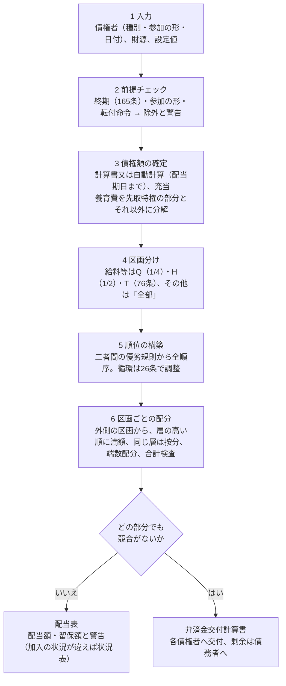

<!-- このファイルは Claude の Docs（債権執行 配当計算アプリ 論点表・エンジン仕様／「Tab 1」タブ）から書き出したもの。直接編集しない。 -->

# 債権執行 配当計算アプリ 論点表・エンジン仕様（初版）

**目次**

- [1 目的・適用範囲](#1-目的適用範囲)
- [2 手続の分岐と配当財源](#2-手続の分岐と配当財源)
- [3 配当を受けるべき債権者と債権の種別](#3-配当を受けるべき債権者と債権の種別)
- [4 順位表](#4-順位表)
- [5 債権に対する担保権の実行・物上代位との競合](#5-債権に対する担保権の実行物上代位との競合)
- [6 扶養義務等債権（養育費・婚姻費用）](#6-扶養義務等債権養育費婚姻費用)
- [7 公債権（租税・公課）](#7-公債権租税公課)
- [8 仮差押えとの競合](#8-仮差押えとの競合)
- [9 債権額の計算](#9-債権額の計算)
- [10 エンジン仕様](#10-エンジン仕様)
- [11 設例（テストケース）](#11-設例テストケース)
- [12 未決事項（要決定）](#12-未決事項要決定)
- [13 出典](#13-出典)

## 1 目的・適用範囲

第三債務者の供託（又は差押債権者の取立て等）で生じた配当財源を、配当を受けるべき各債権者に順位と按分で割り付け、配当表（債権者が1人又は全額弁済可能なときは弁済金交付計算書）を作る。計算エンジンは画面から切り離した純粋関数とし、本書の設例をそのままテストケースにする。

- 対象：(1) 強制執行としての債権執行（民執法143条以下）、(2) 担保権の実行としての債権差押え・物上代位（民執法193条）、(3) これらと仮差押えの執行・配当要求・交付要求が競合する場面
- 対象外（初版）：少額訴訟債権執行の裁判所書記官の手続固有の事項、不動産・動産執行、滞納処分側（徴収職員）が配当する場面、配当異議訴訟後の追加配当の計算
- 構成の前提：houjin-daihyosha・sohikaku と同じく GitHub Pages の静的アプリ。入力はブラウザ内に留め、配当表はブラウザで直接ダウンロードする
- 本書の位置付け：論点の整理と、エンジンが従う規則の初版。法的判断が分かれ得る点は第12章に「要決定」として集める

## 2 手続の分岐と配当財源

配当財源は「区画」に分けて扱う。区画ごとに、配当を受けられる債権者の顔ぶれが違うからである。

### 2.1 弁済金交付か配当か

- 配当等を実施する場合：第三債務者の供託（民執法156条）、売却命令による売却など（同法166条1項）
- 債権者が1人のとき、又は競合が生じない（どの部分でも、複数の債権者が取り合って不足することがない）ときは、弁済金交付計算書を作る。それ以外は配当表を作る（2026-11-26確認）（同法166条2項による84条・85条の準用）
- 余剰は債務者に交付する。エンジンはまず「全額弁済できるか」を判定し、書式を切り替える

### 2.2 財源の区画

給料等（民執法152条）では、差押えできる範囲が債権の種類で異なる。そこで供託金を1支払期ごとに次の区画に分け、区画ごとに配当計算を行う。

| 区画 | 範囲（給料等の手取額に対し） | 配当を受け得る者 | 根拠 |
| --- | --- | --- | --- |
| Q | 1/4 まで（手取額が44万円を超えるときは33万円を超える部分） | 競合する全債権者 | 民執法152条1項、同法施行令2条 |
| H | 1/4 を超え 1/2 まで（66万円超の調整あり） | 扶養義務等債権者のみ | 民執法151条の2、152条3項 |
| 全部 | 差押禁止のない債権（預金、売掛金、賃料等） | 競合する全債権者 | — |

- 区画の入力は2通りを用意する。(1) 支払期ごとの手取額から自動計算、(2) 供託書・事情届の内訳をそのまま入力（自動計算を上書き）
- 手取額が66万円を超えるときは、一般債権も扶養義務等債権も「手取額−33万円」となり、区画Hは生じない（全部が区画Q）
- 一般債権による差押えが競合したときは、差押えの効力が全部に及ぶ（民執法149条）。担保権実行による差押えは優先弁済を受けるため平等配当を考慮する必要がなく、この拡張は生じない
- 区画Hの財源が扶養義務等債権の全額弁済後に余ったときは、差押禁止部分に当たるため債務者に交付する（区画Qの債権者へ回さない）

### 2.3 配当原資の額

- 配当原資＝供託金＋供託利息（供託利息を原資に含める積極説が実務）。供託利息は供託金の受入月と配当日の属する月を除き、1万円未満を切り捨てた金額に付け、1円未満を切り捨てる（供託規升33条）。利率は期間ごとに異なるため設定表で持ち、現行利率は実装前に確認する
- 一部差押えに対して全額が供託されたときは差押額だけが原資。超過部分は弁済供託であり、配当の対象外（配当加入遮断効も生じない）
- 滞納処分の一部解除後などで内渡し済みの場合は、内渡し額を控除する
- 配当要求は差押えの範囲を広げない。継続的給付で拡張するかは見解が分かれ、第三債務者が複数の場合に対応できる非拡張説を初期値とする（D-15）

### 2.4 仮差押えのみを原因とする供託（みなし解放金）

- 第三債務者が仮差押えのみを理由に供託すると（民事保全法50条5項、民執法156条1項の準用）、債務者が仮差押解放金に相当する金銭を供託したものとみなされ、仮差押えの効力は債務者の供託金還付請求権に及ぶ（同法50条3項本文）
- この供託では配当要求の終期は来ない。還付請求権に対する最初の差押命令（仮差押債権者自身の本執行を含む）が供託所に送達された時に民執法156条の供託に転化し、その時が終期（同法165条1号）となる。供託官が事情届を出し、供託書正本は仮差押えの記録にある
- 仮差押解放金の額を超える部分は解放金とみなされない（同法50条3項ただし書）。仮差押えの範囲（給料等は1/4）を超える部分とともに弁済供託に当たり、仮差押債権者は加入せず、還付請求権に対する差押え等が競合した時が終期。競合がなければ配当の対象外。差押禁止（152条）は還付請求権に及ばない（救済は153条）。給料等で複数の供託にわたるときは古い供託から解放金の額まで充てる（確定。仮差押えから本執行に移った債権者は、本差押え自体の効力発生の時から加入）
- 実装：供託金に「仮差押えのみを原因とする供託」の印、最初の差押命令の送達日時、仮差押解放金の額を持たせる。配当加入は送達日時で判定し、どの部分の終期にも間に合わない債権者は除外として示す。解放金を超える部分は別の部分として状況表に示す。供託利息は供託日から計算して金額で按分する。給料等では手取額から1/4を超える部分を分ける。詳細は「論点整理」タブの第2
- 複数の仮差押えが競合したまま供託されたときは合算方式：解放金とみなす額を各仮差押えの解放金の額の合計までとし、その範囲を全員で按分する。各仮差押債権者は自分の解放金の額まで（保全法50条5項による民執法149条の準用からの推論。確定）。解放金の額は仮差押えごとに入力し、空欄なら請求債権額とする

### 2.5 混合供託

- 第三債務者が、債権の帰属に争いがあることなどを理由に、弁済供託（民法494条）と執行供託（民執法156条）を兼ねた供託をしたときは、還付請求権が債務者に属することが明らかになるまで配当はできない
- それを明らかにする文書の例：帰属を争う者との間で、債務者が還付請求権を有することを確定した判決や和解調書、関係者全員の合意書、譲受人とされる者の承諾書。これが出れば、通常の執行供託と同じに配当する
- 物上代位の目的債権が譲渡されても、抵当権の登記が譲渡の対抗要件より先なら、抵当権者は物上代位できる（最判平10.1.30民集52巻1号1頁）。この場合は譲受人との帰属の争いにならないので、通常の執行供託として扱う
- アプリでは供託ごとに「混合供託」と「還付請求権が債務者に属することを証明する文書の提出あり」を入力する。提出前は警告し、配当表に「参考計算」と表示する

## 3 配当を受けるべき債権者と債権の種別

配当を受けられるのは、終期までに差押え、仮差押えの執行又は配当要求をした債権者である（民執法165条）。エンジンは各債権者の「効力発生日」と終期を比べ、終期後のものを除外候補として警告する。

- 終期：第三債務者が差押えに基づいて供託した時（供託金の受入日。時刻まで比べる）、取立訴訟の訴状が第三債務者に送達された時、売却命令により執行官が売得金の交付を受けた時など（同条各号）。供託と訴状送達が両方あれば早い方
- 仮差押えだけに基づく権利供託では終期は来ない。滞納処分が先行した場合は、供託があれば供託時、徴収職員が直接取り立てて残余を交付したときはその交付時
- 参加の効力発生時：差押え・仮差押えは第三債務者への送達時、配当要求・交付要求は執行裁判所の受理時
- 差押えの申立てをしただけでは足りない。先取特権に基づく物上代位の差押え申立てでも同じである（[最判平5.3.30民集47巻4号3300頁](https://www.courts.go.jp/hanrei/56363/detail2/index.html)）
- 担保権を持つだけで差押えをしていない者は、順位が上でも配当を受けられない
- 配当要求ができるのは、執行力のある債務名義の正本を有する債権者と、文書で先取特権を証明した債権者である（民執法154条1項）
- 給料等では、支払期ごとに (1) 差押命令の送達と供託の先後、(2) 差押債権目録の範囲（「送達時に支払期にある」か「送達後に支払期が到来する」か等）の2点で配当加入を判定する

| 種別コード | 債権者の種別 | 参加の形 | 区画 | 配当表上の扱い |
| --- | --- | --- | --- | --- |
| GEN | 一般債権者 | 差押え・配当要求 | Q | 按分 |
| SUP | 扶養義務等債権者（先取特権の部分とそれ以外に分割。SUP3・SUP2） | 差押え・配当要求・担保権実行 | Q・H | 第6章 |
| SEC-PLG | 債権質権者 | 担保権実行の差押え | Q | 第5章 |
| SEC-MTG | 抵当権者（物上代位） | 担保権実行の差押えに限る | Q | 第5章 |
| SEC-SPP | 特別先取特権者（動産売買先取特権の物上代位等） | 担保権実行の差押え・先取特権に基づく配当要求 | Q | 第5章 |
| GPP | 一般先取特権者（雇用関係等） | 担保権実行の差押え・配当要求 | Q | 第4章 |
| TAX | 租税（国税・地方税） | 交付要求・滞納処分による差押え | Q（滞納処分の差押えはT） | 第7章 |
| PUB | 公課（社会保険料等） | 同上 | Q（滞納処分の差押えはT） | 第7章 |
| PRV | 仮差押債権者 | 仮差押えの執行 | Q | 配当額を供託（第8章） |

区画欄は給料等の場合である。差押禁止のない債権では全員が「全部」区画に入る。租税・公課の差押禁止範囲は国税徴収法76条によるため、民執法の区画とは一致しない（要決定 D-6）。預金等と給料等の両方を差し押さえた事件では、供託金ごとに差押債権の種類を指定し（fund.kind = 'mixed'、供託金の debtKind）、給料等の供託金だけを区画に分ける。預金等の供託金では全員が「全部」区画に入る。

## 4 順位表

順位は固定の層ではなく、担保権と租税の間では日付の先後で入れ替わる。そこでエンジンは「二者間の優劣規則」を並べ、そこから全順序を組み立てる。下表はその規則を層にならべた原則形である。

| 層 | 内容 | 層内の分け方 | 根拠 |
| --- | --- | --- | --- |
| 0a | 第三債務者の供託費用（義務供託に限り、事情届の提出時までに請求されたもの。供託額が上限） | — | 民訴費用法28条の2。実務上、手続費用にも優先 |
| 0b | 手続費用＝共益費用となる執行費用（配当期日呼出状等・支払委託書の送付費用、特別代理人選任費用、売却手数料等） | 立替者ごと | 民法329条2項ただし書。租税にも優先（国税徴収法9条、地方税法14条2項） |
| 1 | 担保権（質権、抵当権の物上代位、特別先取特権） | 担保権相互の順位（対抗要件・登記の先後等）。根抵当権は請求債権額と極度額の少ない方 | 民法。租税との優劣は国税徴収法15条・16条・19条・20条 |
| 2 | 租税 | 担保を徴した租税が優先、次に交付要求先着手（みなし交付要求を含む）。国税と地方税は同列 | 国税徴収法8条・13条・14条、地方税法14条・14条の8等 |
| 3 | 公課 | 租税と同じ原則 | 国税徴収法8条、各根拠法（租税は公課に常に優先） |
| 4 | 一般先取特権 | 共益費用 ＞ 雇用関係 ＞ 子の監護の費用 ＞ 葬式の費用 ＞ 日用品の供給。同順位内は按分。子の監護の費用は種別「扶養義務等債権（子の監護費用の先取特権）」で扱い、一般先取特権の種類としては選ばせない（民法308条の2の被担保債権は民執法151条の2第1項各号の義務に係る債権と一致し、152条3項により区画Hにも加入するため） | 民法306条・329条1項・332条 |
| 5 | 一般債権（扶養義務等債権のうち先取特権の部分以外、共益費用とならない執行費用を含む） | 按分 | 債権者平等 |

差押債権者が自分の手続のために支出した執行費用（申立手数料、差押命令の送達費用など）は、共益費用に当たらない。その債権者の債権の「費用」として、元の債権と同じ順位で按分に加える。費用として取り込むのは差押命令の請求債権に含まれている額に限り、配当の段階で計算書に新たに書き加えた費用は取り込まない（実務上の扱い）。

層をまたぐ例外として、次のものを規則として持つ。

- 担保権と租税：担保権の設定（対抗要件）が法定納期限等以前なら担保権が優先、後なら租税が優先。租税の個別の法定納期限等ごとに判定する
- 先取特権の順序：共益費用 ＞ 特別の先取特権 ＞ 一般の先取特権（民法329条）。特別の先取特権相互は民法330条・331条
- 先取特権と公租公課：不動産保存・工事の先取特権など国税徴収法19条・20条のものを除き、公租公課が優先。子の監護の費用も同じ（国税徴収法8条、地方税法14条等）
- 先取特権と抵当権の物上代位：先取特権に基づく差押命令の第三債務者への送達日と抵当権設定登記の日の先後
- 債権質権と抵当権の物上代位：質権の対抗要件具備時と抵当権設定登記の日の先後。抵当権相互は担保権の順位
- 同順位の先取特権者が数人あるとき（養育費債権者が複数など）は、債権額の割合で按分（民法332条）
- 先取特権の利息・損害金で優先するのは最後の2年分に限り、超える部分は一般債権と同順位（民法341条による375条の準用）
- 仮差押債権者は、配当時に実体法上の優先権を主張できない
- 優劣が循環する場合は国税徴収法26条（地方税法14条の20）の方法で計算する（D-5確定）。(1) 公債権のグループと私債権のグループに分け、公債権相互の順位を一切考慮せずに各グループの配当額を定める。(2) 公債権グループの額を、交付要求先着手等の原則で個々の公債権に配り直す

## 5 債権に対する担保権の実行・物上代位との競合

担保権者が優先配当を受けるには、参加の形と優先標準時の2点を満たす必要がある。エンジンはどちらかを欠く担保権者を一般債権者として扱い、その理由を警告に出す。

### 5.1 参加の形

- 抵当権の物上代位：担保権実行としての差押えが必要。他の債権者の債権差押事件への配当要求では優先弁済を受けられない（[最判平13.10.25民集55巻6号975頁](https://www.courts.go.jp/hanrei/52333/detail2/index.html)）
- 動産売買先取特権の物上代位：強制執行（債務名義）で差し押さえた場合でも、競合する債権者がいれば、終期までに担保権を証する文書を出して先取特権に基づく配当要求又はこれに準ずる申出が必要（[最判昭62.4.2集民150号575頁](https://www.courts.go.jp/hanrei/70483/detail2/index.html)）
- 先取特権者は、一般債権者の差押え又は仮差押えの執行の後でも、物上代位権を行使できる（[最判昭60.7.19民集39巻5号1326頁](https://www.courts.go.jp/hanrei/52697/detail2/index.html)）
- 一般先取特権（雇用関係・子の監護費用等）：担保権実行としての差押え（民執法193条）又は文書による配当要求（同法154条1項）

### 5.2 優先標準時

| 担保権 | 一般債権者の差押えとの優劣 | 租税との優劣 |
| --- | --- | --- |
| 抵当権（物上代位） | 差押命令の第三債務者への送達と抵当権設定登記の先後（[最判平10.3.26民集52巻2号483頁](https://www.courts.go.jp/hanrei/52793/detail2/index.html)） | 設定登記と法定納期限等の先後（国税徴収法16条） |
| 債権質権 | 対抗要件（確定日付のある通知・承諾）と差押命令送達の先後 | 設定と法定納期限等の先後（同法15条） |
| 特別先取特権（物上代位） | 差押えの後でも行使可（前掲昭60.7.19） | 先取特権の種類ごと（同法19条・20条に当たるか） |
| 一般先取特権 | 常に優先 | 租税が優先（同法8条） |

### 5.3 相対的優劣の問題

抵当権の物上代位では、登記前に差し押さえた一般債権者Aには優先できず、登記後に差し押さえた一般債権者Bには優先する、という相対的な関係が生じ得る。AとBは同順位なので、単純な層では表せない。

計算は吸収方式による（D-7確定）。(1) 抵当権者M・A・Bをいったん同順位として按分する。(2) Mは、自己に劣後するBの按分額から、自己の不足額に満つるまで吸収する。(3) Aの配当額は変わらない。仮差押え後に設定された抵当権など、処分禁止効が相対的に働く場面の配当と同じ考え方である。

転付命令が競合前に効力を生じた場合は配当に至らないため、入力段階の前提チェックとする。

## 6 扶養義務等債権（養育費・婚姻費用）

扶養義務等債権は、「区画Hを独占できる」ことと、「一部が一般先取特権で優先する」ことの2点で一般債権と異なる。エンジンは1本の債権を各期の定期金ごとに分解し、先取特権の部分とそれ以外に分けて持つ。

### 6.1 差押えの特例

- 期限未到来の定期金も差し押さえられるが、各定期金の確定期限の到来後に支払期が来る給料等に限る（民執法151条の2）
- 差押禁止は1/2に縮む。強制執行（同法152条3項）だけでなく、先取特権の実行による差押え・配当要求でも同じ（同法193条2項による152条3項の準用。D-2確定）。これが区画Hの根拠
- 配当要求でも、同法151条の2の類推により期限未到来の定期金を配当要求債権に含められる。その部分は、確定期限の到来後に支払期が来る給料等についてのみ配当に加わる
- 配当対象になるのは、各回の供託に係る支払期までに確定期限が到来した未払分だけ。将来分は次回以降の供託で配当する（第9章の回次管理）

### 6.2 子の監護費用の先取特権

- 改正民法で306条に「子の監護の費用」が3号として加わった（[令和6年法律第33号](https://www.shugiin.go.jp/Internet/itdb_housei.nsf/html/housei/21320240524033.htm)）。民法329条1項により、雇用関係の次、葬式の費用の前の順位となる
- 対象は、夫婦間の扶助（752条）、婚姻費用の分担（760条）等の義務に係る確定期限の定めのある定期金債権（民法308条の2）
- 上限：各期について「月額8万円×扶養を受けるべき子の数」（[令和7年法務省令第56号1条](https://www.moj.go.jp/content/001452581.pdf)）
- 施行日は令和8年4月1日。施行日前に取り決めたものは、施行日以後に生じた各期の定期金に限り先取特権が及ぶ（[法務省資料](https://www.moj.go.jp/content/001450931.pdf)。改正法附則第3条第1項）

### 6.3 各期の分解（エンジンの処理）

```text
各期の定期金 p、子の数 n、支払期 d、取決め日 a
if d >= 2026-04-01 または a >= 2026-04-01:
    先取特権部分 = min(p, 80000 × n)
else:
    先取特権部分 = 0
それ以外の部分 = p − 先取特権部分
```

- 扶養義務等債権は次の2つに分けて持つ
  - 先取特権の部分（担保権実行又は先取特権に基づく配当要求をしたもの）：層〘4-子の監護の費用〙、区画Q・H
  - それ以外の部分（上限を超える部分、施行日前の期、先取特権を行使していない部分）：層〘5-一般債権〙、区画Q・H
- 債務名義による強制執行だけでは優先しない。配当要求の終期までに、担保権の実行又は先取特権を証する文書による配当要求が必要（前掲昭62.4.2の趣旨。D-8確定）
- 配当表のそれ以外の部分の請求債権額は、養育費等の債権額から先取特権の部分の被担保債権額を控除した額とする。強制執行側の計算書が控除していなくても、配当表では控除する（エンジンは自動控除し、警告を出す）
- 給料等の配当は、優先的に取れるところから充てる（非競合部分先行充当。D-9確定）
  1. 区画Hを先取特権の部分に優先して充てる
  2. 先取特権の部分が足りなければ、区画Qからも先取特権の部分に優先して充てる
  3. 区画Hに残りがあればそれ以外の部分に充てる
  4. それ以外の部分の残りを按分の基礎として、区画Qの残りを一般債権と按分する
- 手取額が66万円を超えて区画Hがないときは、供託金をまず先取特権の部分に充て、残りをそれ以外の部分と一般債権で一括按分する。手続費用・供託費用は最優先なので、最初に配る部分（区画H）から償還する（2026-11-26確認）
- この順序は、第10章の手順（区画H→Q、各区画で層の高い順）でそのまま実現できる。先取特権の部分が区画Hで満額にならなければ区画Hに残りは出ないからである
- 改正前から係属する給料等の執行でも、施行日以後に生じた期について先取特権に基づく配当要求ができ、先取特権の部分は先行の差押債権者の残債権に優先する

## 7 公債権（租税・公課）

租税は一般債権と一般先取特権に優先するが、どの手続で配当するかは滞納処分と強制執行の先後で決まる。エンジンはまずこの先後で場面を分ける。

| 場面 | 配当する機関 | アプリの扱い |
| --- | --- | --- |
| 強制執行の差押えが先行し、後に滞納処分の差押え | 執行裁判所（徴収職員は配当を受ける側） | 租税を順位表に入れて全体を配当計算 |
| 滞納処分の差押えが先行 | 徴収職員が取立て、残余が執行裁判所へ | 残余額を財源とし、租税を除いて配当計算 |
| 滞納処分なし、交付要求のみ | 執行裁判所 | 租税を順位表に入れて配当計算 |

- 参加の形：執行裁判所への交付要求（国税徴収法82条）。交付要求は配当要求に準じて扱い、配当要求の終期までに執行裁判所が受理したものだけが参加できる（D-10確定）
- みなし交付要求（滞調法36条の10）：(1) 強制執行の差押え後に滞納処分の差押えをし、配当期日等までに執行裁判所に通知した場合、(2) 第三債務者の事情届に滞納処分の差押えの表示がある場合、(3) 滞納処分先行で強制執行続行決定があった場合
- 租税相互：担保を徴した租税が優先し（国税徴収法14条）、次に交付要求先着手（同法13条）。債権執行では差押先着手はみなし交付要求を通じて交付要求先着手に吸収される。公課相互も同じ
- 租税は公課に常に優先する。手続費用は公租公課にも優先する（国税徴収法9条）
- 債権額：本税・延滞税・加算税等を交付要求書の記載額のまま入力する。延滞税の計算は初版の対象外。配当表の債権の種類の欄には、税目又は公課の名称と、滞納処分による差押えか交付要求かが分かるように書く（例：住民税（滞納処分による差押え）、国民健康保険料（交付要求））
- 法定納期限等は担保権との優劣に使うため、租税1件ごとに入力欄を設ける

### 7.1 給料等での租税の取り分（D-6）

租税がどの区画から取れるかは、交付要求だけか、滞納処分の差押えがあるかで分ける。

| 場面 | 租税が参加する範囲 | 理由 |
| --- | --- | --- |
| 交付要求のみ | 区画Qのみ | 交付要求は配当要求に準じ、差押えの範囲を広げない。民事執行の手続内では、扶養義務等債権以外は民執法152条1項の範囲（区画Q）にとどまる |
| 強制執行が先行し、後に滞納処分の差押え | 滞納処分の差押えが及ぶ範囲（区画Tまで） | 滞納処分の差押えは国税徴収法76条の範囲で独自に及ぶ。第三債務者は差押えに係る債権の全額を供託し（滞調法36条の6）、執行裁判所がみなし交付要求として配当する |
| 滞納処分が先行 | 徴収職員が自ら取り立て、残余だけが執行裁判所に来る | 残余を財源とし、租税を除いて配当する（滞調法20条の7・20条の8）。初版は残余の区画内訳を手入力 |

- 区画T：国税徴収法76条1項で差し押さえられる額。手取額から、同項第4号の額（令和8年4月以降は月10万7千円、生計を一にする親族1人につき4万8千円を加算）と第5号の額（残額の20%。第4号の額の2倍が限度）を引いて求める。給料等は1,000円未満を切り捨て、控除額は1,000円未満を切り上げる（[国税徴収法基本通達76条関係3](https://www.nta.go.jp/law/tsutatsu/kihon/chosyu/05/01/06/076/01.htm)、[政令要綱](https://www.mof.go.jp/tax_policy/tax_reform/outline/fy2026/seirei/youkou/97_choshu.pdf)）
- 区画の一般化：各債権の「差し押さえられる上限」（1/4、1/2、T）を区切りにして区画を作り、参加者の少ない（上限の大きい）区画から順に配る。非競合部分先行充当（D-9）をそのまま広げたもので、Tが1/2より大きければ 「1/2〜T：租税のみ」→「区画H：租税＞先取特権の部分＞それ以外の部分」→「区画Q：全員」の順になる
- 交付要求のみでは区画Hから配当を受けられない（D-6確定）

## 8 仮差押えとの競合

仮差押債権者にも本来の順位で配当額を算出し、その額は交付せずに供託する（民執法166条2項による91条1項2号の準用）。配当表には「供託」の列を設け、配当額と交付額を分けて示す。

- 配当期日までに債務名義（執行文付き正本と送達証明）が提出されれば、仮差押債権者として留保なしに配当する。提出がなければ支払留保（供託金なら支払委託の留保、保管金なら配当留保供託）
- 按分の基礎は仮差押えの請求債権額が上限。債務名義の額がそれより大きくても、その債務名義で差押え又は配当要求をしていなければ仮差押えの額にとどまる。債務名義の額が小さいときはその額で計算し直し、差額は一部取下げ又は支払留保
- 仮差押えの手続費用は執行費用に当たらないため、債権額に含めない（D-11確定）
- 仮差押債権者が同じ被保全債権で本執行の差押えをしたときは、1人の債権者としてまとめる。(1) 請求債権額が同じなら、配当表には差押事件の欄だけを置き、備考に仮差押事件の番号と本執行に移行した旨を書く（近藤基「債権配当の実務と書式〔第3版〕」181～221頁（民事法研究会・2021年））。(2) 本差押えの請求債権額のほうが小さいなら、その額までは本差押えの欄で配当し、本差押えに引き継がれなかった仮差押えの部分は仮差押えの欄に残して支払を留保する（民執法166条2項による91条1項2号の準用）。(3) 本差押えの請求債権額のほうが大きいなら、本差押えの額を按分の基礎とする
- 本執行移行でない別債権の差押えであれば、仮差押債権者と差押債権者のそれぞれの地位で配当する。入力画面では本差押えの欄で「元の仮差押え」を選ばせ（fromPrv）、二重計上を防ぐ。実装：仮差押えの請求債権額の範囲は仮差押えの執行の時から配当加入し、超える部分は本差押えの効力発生の時から加入する（超える部分の効力発生が終期後なら除く）。本差押えが小さいときは、仮差押えの残部を別欄にして支払留保とする。配当加入等の状況表は、統合前の参加者で部分を区別する。次回へ繰り越すと、本差押えは仮差押えの時から加入している本差押えとして紐付けを外し、全部移った仮差押えの欄は外す
- 仮差押債権者は優先権を主張できない。本案で敗訴したときは、留保分が追加配当の原資になる（追加配当でも差押債権額を上回る配当はしない）

## 9 債権額の計算

配当の基礎となる債権額は、配当期日（又は弁済金交付日）までの利息・遅延損害金を含む額である。配当表には元本・利息その他の附帯債権・執行費用を分けて記載する（民執法166条2項による85条の準用）。

### 9.1 計算書と自動計算

- 債権者からの計算書（民事執行規則145条による60条の準用）の額をそのまま入力する方式と、元本・利率・起算日から自動計算する方式を両方持つ。実装：計算行（欄・元金・年利・起算日・終期・うるう年の扱い）を債権ごとに複数持ち、終期が空欄なら配当期日まで計算して、利息・損害金欄の確定額に加える。日数は起算日と終期の両日を含み、1円未満切捨て。「年365日の日割」（うるう年も365日で割る）と「うるう年の日は366日で割る」を選べる
- 附帯請求の日割計算は1円未満を切り捨てる（計算の便宜と債務者に有利という考慮による実務。国・地方公共団体等が当事者のときは国等の債権債務等の金額の端数計算に関する法律でも切捨て）
- 配当期日までの利息・損害金は、計算書に記載があれば加算する（D-12確定）。差押命令の請求債権の利息等の算出期間の末日の翌日から配当期日まで。継続的な配当の2回目以降は、前回配当期日の翌日から今回配当期日までを前回配当後の残額に加算する。過去の配当の充当をやり直すことは認めない
- 計算書で「配当期日までの利息等は債権額に加えない」とされたとき、又は計算書の提出がないときは、差押命令の請求債権額のままとする
- 担保権実行（先取特権）の附帯請求：請求債権が元金のみなら、計算書で損害金を加える拡張は認めない。申立日までの損害金を含めていれば、配当期日までの拡張を認める（最判平21.7.14民集63巻6号1227頁、最決平29.10.10民集71巻8号1482頁の趣旨）
- 配当期日までの利息等を含めたときは、配当表の備考にその旨を表示する

### 9.2 充当

- 配当額は、費用 → 利息（遅延損害金）→ 元本の順に充当する（民法489条）。配当には合意充当・指定充当を適用せず、法定充当による
- 扶養義務等債権は、支払期の古い定期金から充当する
- 強制執行として（それ以外の部分として）受けた配当等も、法定充当により先取特権の付いた部分から充当する（民法488条4項2号の類推）。たとえば月10万円（うち8万円に先取特権）の期に2万円の配当があれば、被担保債権の残りは6万円となる。被担保債権額は不変とする見解に切り替えられるようにしておく（D-14）
- 担保権実行として（先取特権の部分として）受けた配当等は先取特権の部分の被担保債権に充当し、それ以外の部分には及ばない

### 9.3 端数処理

- 按分で生じる小数点以下の金額は、小数点以下の数字の大きい債権者から切り上げる（D-13確定。近藤基「債権配当の実務と書式〔第3版〕」187頁（民事法研究会・2021年））。数字が同じときは配当表の記載順。記載順で配る方式にも切り替えられる
- どの方式でも、配当額の合計が区画の財源と一致すること、各債権の配当額が債権額を超えないことを不変条件として検査する

### 9.4 継続的給付の回次管理

- 給料等は供託のたびに配当する（特例債権の供託金は、事情届1件ごとに提出後1か月以内が目安）。各回を「回次」として保存し、前回までの受領額を差し引いた残債権を次回に繰り越す。実装（HT.carryForward）：今回の配当（留保分を含む）を費用→利息→損害金→元金の順に充当した残額を次回の請求債権にし、D-14の先取特権の部分とそれ以外の部分の振替え、2年分を超える部分の残り、根抵当権の極度額の残りも引き継ぐ。終期が空欄の計算行は配当期日の翌日から、充当で減った元金を基礎に続ける。完済した債権は外すが、扶養義務等債権の行は新しい期を同じ差押えのもとで加えるため0円でも残す。各回の入力は丸ごと「これまでの回次」として同じJSONに残し（1事件＝1ファイル）、過去の回の配当表をいつでも表示・印刷・Excel保存できるようにする。誤って繰り越したときは「この回に戻す」でその回の入力に戻る
- 数回分の供託金を1回の配当期日で配当するときは、供託日の古いものから1つずつ計算する。各供託金で区画H、区画Qの順に配り、次の供託金の按分は、それまでの供託金から受けた額を差し引いた残りの債権額を基礎にする
- 支払期ごとに配当に加わる債権者が異なり得る（第3章）ため、供託金ごとに参加者を判定する
- 保存は利用者の端末内のファイル（JSONの書き出し・読み込み）に限り、サーバーには残さない
- 各回で新たに確定期限が到来した扶養義務等債権の定期金を加算する

### 9.5 配当異議と留保

配当異議の申出があった債権者の分、停止条件付・不確定期限付の債権の分は、「供託」フラグと理由を付けて配当額を供託欄に移す（民執法166条2項による91条1項の準用）。

実装（HT.additionalDistribution）：留保分ごとに結果（支払う／配当できなくなった／債権額を減らす／債権者間の配当異議）を選んで追加配当表を作る。配当できなくなったとき・債権額を減らすときは全債権者のために配当表を変更し（民執法92条2項）、債権者間の配当異議は原告と被告の間だけで解決する（最判平6.7.14民集48巻5号1109頁）。詳細は「論点整理」タブの9-6。債務者の仮差押解放金・残余金・売得金・執行停止中の供託・転付命令の扱いも同タブの第9にまとめた

## 10 エンジン仕様

エンジンは「区画 × 順位の層 × 層内按分」の三段で配る純粋関数 `distribute(input, settings) → result` とする。画面と出力（Excel・docx）はこの結果を表示するだけで、計算を持たない。



*配当エンジンの処理の流れ · 6段階と1分岐*

中心は第6段階である。順位や区画の法的判断は第2・4・5段階の規則として切り出し、第6段階は法を知らない単純な配分にする。

### 10.1 データモデル

| 対象 | 主な項目 |
| --- | --- |
| 債権者 | ID、氏名、種別コード（第3章）、参加の形、効力発生日（差押命令送達日等）、対抗要件日（登記・確定日付）、法定納期限等（租税）、一般先取特権の種類、先取特権主張の有無、紐付け先（仮差押え→本差押え）、異議・条件付フラグ |
| 債権 | 元本、利息・損害金（利率・起算日又は計算書の額）、執行費用、共益費用たる手続費用 |
| 定期金（扶養義務等） | 支払期、額、子の数、取決め日、既払額 |
| 財源（回次） | 供託日、供託額、区画の内訳（手取額から自動計算又は手入力）、配当期日 |
| 設定 | D-1〜D-13 の選択 |
| 結果 | 債権者ごとの区画・層・債権額内訳・配当額・交付額・供託額と理由、債務者への余剰、警告の一覧 |

### 10.2 配分の手順（第6段階）

```text
for region in 区画の処理順（給料等は外側の区画から（H→Q。D-9）、その他は「全部」）:
    eligible = region に参加できる債権（残額 > 0）
    layers   = 順位の層（第5段階の結果を eligible に絞る）
    rest     = fund[region]
    for layer in layers:
        need = layer 内の残額の合計
        if rest >= need: 全額を配る; rest -= need
        else:            按分(rest, layer); rest = 0; break
    配った額を各債権の残額から差し引く（次の区画へ）
    rest > 0 なら債務者へ
仮差押え・異議・条件付の配当額を供託欄へ移す
```

### 10.3 不変条件（全テストで検査）

- 区画ごとに、配当額の合計＋債務者への余剰＝財源
- どの債権者も、配当額の合計が債権額を超えない
- 区画Hから配当を受けるのは扶養義務等債権だけ（D-6を「受けられる」とした場合を除く）
- 上位の層が満額にならないうちは、下位の層に配当しない

### 10.4 出力（配当表の記載）

順位欄の扱い：部分（供託）ごとに配当加入する債権者の顔ぶれが異なり、かつ債権者間で順位がそろわないときは、順位欄を空欄にし、行を差押え等の順に並べる（書籍の参考例XVI-4の記載にならう）。各部分での優劣は、配当加入等の状況表の部分ごとの配当額で示す。債務者欄の表記は「債務者」と「債務者兼所有者」（物上代位の事案）から選べる。

書式は近藤基「債権配当の実務と書式〔第3版〕」181頁以下（民事法研究会・2021年）の配当表例・弁済金交付計算書例に合わせる。画面・印刷（A4横）・Excel で同じ形にする。

- 上段：左に配当日・裁判所・裁判所書記官（弁済金交付計算書は裁判官）、中央に表題と事件番号（すべて）、右に売得金・供託金・供託利息・合計・債務者
- 列：順位｜債権者／債権の種類・事件番号｜費用・利息・損害金・元金（4段）｜合計｜配当実施額｜充当額（4段）｜充当後残額（4段）｜備考
- 行の順序：手続費用（供託費用があればその前）→ 配当の順位 → 同順位は差押えの順（事件番号順）→ 剰余金があれば債務者を最後（同書184頁・200頁）
- 差押え・仮差押えの事件ごとに1行。同じ債権者でも差押えが別なら別行
- 充当は費用・利息・損害金・元金の順（民法489条）。租税は本税を損害金欄、延滞税を元金欄に置く（国税徴収法129条6項。同書187頁）
- 備考：手続費用の項目、支払留保、仮差押えの本執行移行、債権計算書提出なし、取立届あり、担保権の受付番号・極度額・順位番号、養育費の対象期間（「元金欄に記載された金額は、令和○年○月分までの養育費債権である」）、配当期日までの損害金を含む旨（同書188〜190頁）
- 配当加入等の状況表：債権者によって配当加入の状況が異なるとき（給料等の区画、供託金ごとに参加者が違う場合）に2枚目として付ける（同書202頁以下）
- 合意配当：全債権者が合意した配当額を入力できるようにし、合計が原資と一致すること、各債権の請求債権額を超えないこと、手続費用を変えていないことを検査する。残りは債務者に交付。合意が検査を通らなければ計算による配当を表示して警告する

## 11 設例（テストケース）

各設例の「期待値」はそのままエンジンの単体テストにする。端数は方式(1)（端数の大きい順に1円ずつ）、金額の単位は円。要決定事項に依存する設例は、そのIDを付して方式ごとの期待値を並べる。

### 設例1：一般債権のみ（預金債権）

供託額 1,000,000（供託利息は省略）。手続費用（配当期日呼出状・支払委託書の送付費用） 6,000 をXが予納。配当財源 994,000 を按分。各債権額には、差押命令の請求債権に記載された申立手数料等の執行費用を含む。

| 債権者 | 参加の形 | 債権額 | 配当額 |
| --- | --- | --- | --- |
| X | 差押え | 1,240,000 | 513,567（ほか手続費用 6,000） |
| Y | 差押え | 800,000 | 331,333 |
| Z | 配当要求 | 360,000 | 149,100 |
| 計 | — | 2,400,000 | 994,000 |

端数の1円は、小数点以下が最も大きいX（.67）に配分。

### 設例2：一般債権＋養育費（給料、手取 300,000）

区画Q 75,000、区画H 75,000。X（一般）500,000。W（養育費、子1人、月60,000×到来未払2か月）120,000。

**2-1 先取特権あり**（各期が令和8年4月以後。Wの120,000は全額先取特権部分。Wは先取特権に基づく配当要求をした前提）

| 区画H | 区画Q | W計 | X計 | 債務者 |
| --- | --- | --- | --- | --- |
| W 75,000 | W 45,000（層4でXに優先）、X 30,000 | 120,000 | 30,000 | 0 |

**2-2 先取特権なし**（各期が施行日前で、取決めも施行日前）

| 区画H | 区画Q（按分） | W計 | X計 |
| --- | --- | --- | --- |
| W 75,000 | X 68,807、W 6,193（Wの残債権45,000で按分） | 81,193 | 68,807 |

**2-3 先取特権の部分とそれ以外が並ぶ場合**（手取 400,000。区画Q 100,000、区画H 100,000。W：子1人、月100,000×2か月。先取特権の部分 160,000、それ以外 40,000。X 500,000）

| 手順 | 区画 | 配当 |
| --- | --- | --- |
| (1) 先取特権の部分に優先 | H 100,000 | W先取特権 100,000（残 60,000） |
| (2) 先取特権の部分の不足を優先 | Q 100,000 のうち | W先取特権 60,000 |
| (3) Hの残りをそれ以外の部分へ | H 残 0 | なし |
| (4) Qの残りをそれ以外の部分と一般債権で按分 | Q 残 40,000 | Wそれ以外 2,963、X 37,037 |
| 計 | 200,000 | W 162,963、X 37,037 |

**2-4 手取66万円超（区画Hなし）**（手取 800,000。差押可能額は一般・扶養とも 470,000。WとXは2-3と同じ）

| 手順 | 配当 |
| --- | --- |
| (1) 先取特権の部分に優先 | W先取特権 160,000 |
| (2) 残 310,000 をそれ以外の部分と一般債権で一括按分 | Wそれ以外 22,963、X 287,037 |
| 計 | W 182,963、X 287,037 |

### 設例3：抵当権の物上代位＋租税の交付要求（賃料債権）

供託額 2,000,000。M：抵当権（設定登記2024-05-01）に基づく物上代位の差押え、被担保債権 1,500,000。T：国税の交付要求 800,000。X：一般債権の差押え（送達2025-06-01） 1,000,000。

| パターン | Tの法定納期限等 | 順位 | M | T | X |
| --- | --- | --- | --- | --- | --- |
| 3-1 | 2025-03-31（登記後） | M ＞ T ＞ X | 1,500,000 | 500,000 | 0 |
| 3-2 | 2024-03-31（登記前） | T ＞ M ＞ X | 1,200,000 | 800,000 | 0 |
| 3-3 | 3-1でXの送達が2024-04-01（登記前） | MはXに優先しない | D-7確定後に記入 | 同 | 同 |

### 設例4：仮差押えと終期後の配当要求（預金債権）

供託額 600,000。

| 債権者 | 参加の形 | 債権額 | 配当額 | 交付額 | 供託額 |
| --- | --- | --- | --- | --- | --- |
| X | 差押え | 400,000 | 200,000 | 200,000 | 0 |
| P | 仮差押え | 800,000 | 400,000 | 0 | 400,000 |
| Y | 配当要求（終期後） | 300,000 | 除外（警告） | — | — |

### 設例5：一般先取特権の順位（預金債権）

供託額 500,000。E：雇用関係の先取特権（文書による配当要求）300,000。W：養育費（子1人、月100,000×到来未払2か月）200,000。うち先取特権の部分は月80,000×2＝160,000、それ以外の部分は40,000。X：一般 500,000。

| 順位 | 債権 | 債権額 | 配当額 |
| --- | --- | --- | --- |
| 4-雇用関係 | E | 300,000 | 300,000 |
| 4-子の監護の費用 | W（先取特権部分） | 160,000 | 160,000 |
| 5-一般（按分） | X | 500,000 | 37,037 |
| 5-一般（按分） | W（それ以外の部分） | 40,000 | 2,963 |

## 12 未決事項（要決定）

初版のエンジンは「初期値」で実装し、各項目を設定で切り替えられるようにしておく。結論が出たものから初期値を確定し、設例を更新する。

| ID | 論点 | 状態 | 採用する扱い（未決は仮の初期値） |
| --- | --- | --- | --- |
| D-1 | 第1順位とする費用の範囲 | 確定 | 供託費用＞手続費用（呼出状・支払委託書の送付費用等）。申立手数料・送達費用は各債権と同順位（第4章） |
| D-2 | 先取特権の実行に151条の2・152条3項が及ぶか | 確定 | 及ぶ（193条2項）。配当要求も同じ |
| D-3 | 子の監護費用の先取特権と公租公課 | 確定 | 公租公課が優先 |
| D-4 | 先取特権と抵当権の物上代位 | 確定 | 先取特権の差押命令送達日と設定登記の日の先後 |
| D-5 | 優劣が循環する場合の調整 | 確定 | 国税徴収法26条の2段階計算を初版から実装 |
| D-6 | 租税・公課が区画Hから配当を受けられるか | 確定 | 交付要求のみは区画Qに限る。滞納処分の差押えがあれば国税徴収法76条の範囲（区画T）まで（7.1） |
| D-7 | 抵当権の物上代位における相対的優劣の計算 | 確定 | 吸収方式（5.3） |
| D-8 | 債務名義による差押えの養育費債権者の優先 | 確定 | 終期までに担保権実行又は文書による配当要求がなければ全額をそれ以外の部分とする |
| D-9 | 扶養義務等債権の区画Q・H間の充当順序 | 確定 | 非競合部分先行充当（6.3） |
| D-10 | 交付要求と配当要求の終期 | 確定 | 終期までに受理されたものに限る。みなし交付要求を含む |
| D-11 | 仮差押債権者の債権額に費用を含めるか | 確定 | 含めない。仮差押えの請求債権額が上限 |
| D-12 | 利息・損害金を配当期日まで延ばすか | 確定 | 計算書に記載があれば加算（9.1） |
| D-13 | 按分の端数の配分方法 | 確定 | 小数点以下の大きい債権者から切り上げる（近藤基「債権配当の実務と書式〔第3版〕」187頁（民事法研究会・2021年）。9.3） |
| D-14 | それ以外の部分への配当で先取特権の部分の被担保債権額が減るか | 初期値あり | 法定充当で先取特権部分から減る（不変説に切替可） |
| D-15 | 継続的給付への配当要求で差押えの範囲が広がるか | 初期値あり | 非拡張説（拡張説に切替可） |

## 13 出典

条文は e-Gov 法令検索で現行文を確認してから実装する。判例の要旨は裁判所ウェブサイトの裁判例情報による。

- [最判昭60.7.19民集39巻5号1326頁](https://www.courts.go.jp/hanrei/52697/detail2/index.html)（先取特権者は一般債権者の差押え後も物上代位可）
- [最判昭62.4.2集民150号575頁](https://www.courts.go.jp/hanrei/70483/detail2/index.html)（動産売買先取特権者が強制執行で差し押さえた場合の優先の受け方）
- [最判平5.3.30民集47巻4号3300頁](https://www.courts.go.jp/hanrei/56363/detail2/index.html)（差押えの申立てのみでは165条の債権者に当たらない）
- [最判平10.3.26民集52巻2号483頁](https://www.courts.go.jp/hanrei/52793/detail2/index.html)（一般債権者の差押えと抵当権の物上代位の優劣）
- [最判平13.10.25民集55巻6号975頁](https://www.courts.go.jp/hanrei/52333/detail2/index.html)（抵当権者は配当要求により物上代位できない）
- [民法等の一部を改正する法律（令和6年法律第33号）](https://www.shugiin.go.jp/Internet/itdb_housei.nsf/html/housei/21320240524033.htm)（衆議院）
- [民法第308条の2の規定による子の監護費用の先取特権に係る額の算定等に関する省令（令和7年法務省令第56号）](https://www.moj.go.jp/content/001452581.pdf)
- [民法等の一部を改正する法律の施行期日について（法務省民事局、令和7年11月）](https://www.moj.go.jp/content/001450931.pdf)（経過措置）
- [法務省：民法等の一部を改正する法律について（令和8年4月1日施行）](https://www.moj.go.jp/MINJI/minji07_00357)
- [裁判所：債権差押命令申立書（扶養義務等に係る定期金債権及び一般債権による差押え）記載例](https://www.courts.go.jp/assets/202510saiken-kisairei5.pdf)

* 近藤基「債権配当の実務と書式〔第3版〕」181～221頁（民事法研究会・2021年）（XV 配当表および弁済金交付計算書の記載事項について、XVI 比較的複雑な配当における配当表の見方について）。配当表の書式、配当加入等の状況表、端数処理（187頁）。参考例XV-1〜XV-3・XV-5・XVI-1・XVI-3・XVI-4をテストの期待値に使う
